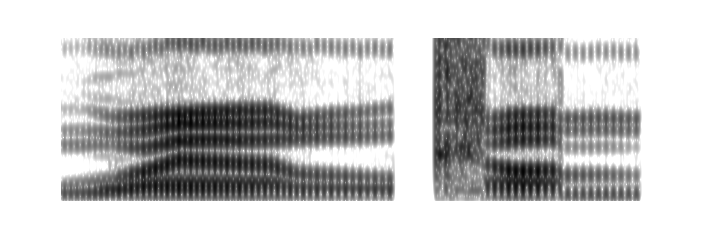
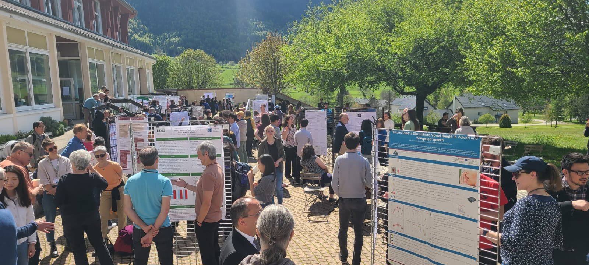
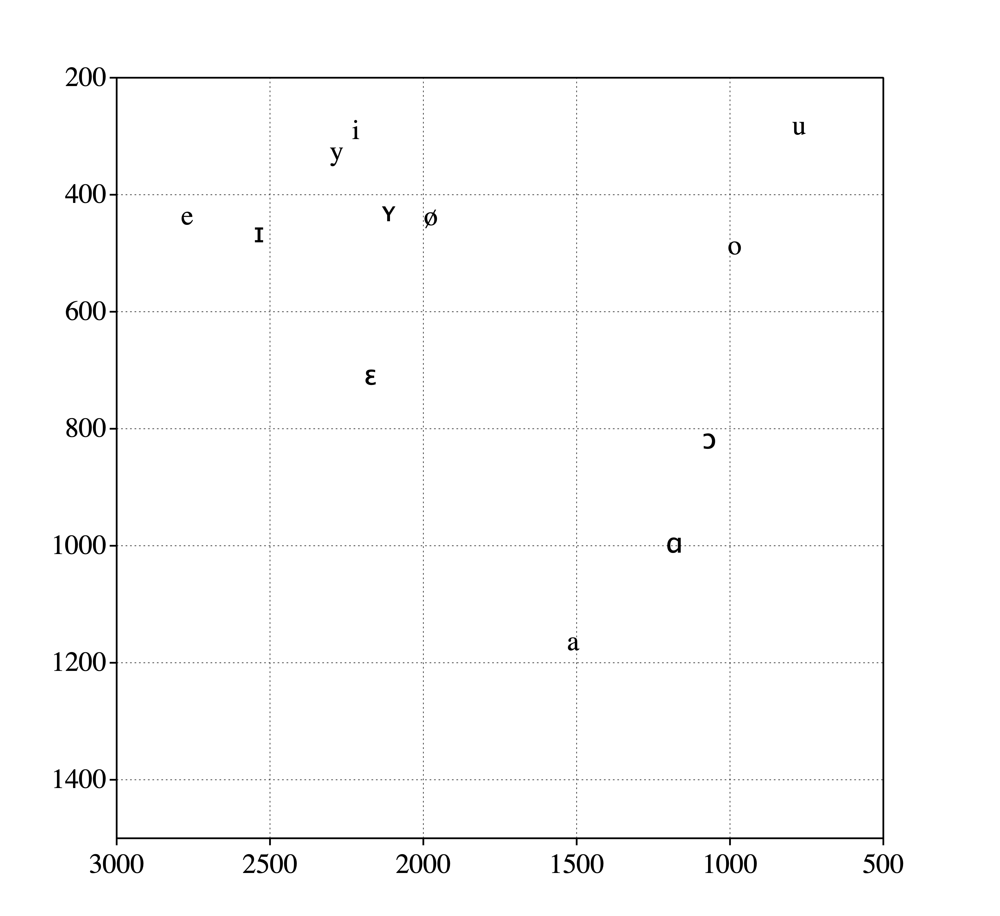

````{=html}
<head>
		<title>Xinyu Zhang's Page</title>
		<meta charset="UTF-8">
		<!-- Global site tag (gtag.js) - Google Analytics -->
		<script async src="https://www.googletagmanager.com/gtag/js?id=UA-143097840-1"></script>
		<script>
 		window.dataLayer = window.dataLayer || [];
  		function gtag(){dataLayer.push(arguments);}
  		gtag('js', new Date());
  		gtag('config', 'UA-143097840-1');
		</script>
</head>
```` 

```{r, echo=FALSE, out.width="100%"}

```


## Bio

I am Xinyu Zhang*, linguist in training. I am currently a PhD candidate at [CLS Radboud](https://www.ru.nl/cls/) and [International Max Planck Research School for language sciences](https://www.mpi.nl/department/imprs-graduate-school/13/people). 

For my PhD project, I study the relationship between speech production and speech perception, by looking at both typical and clinical populations.

Previously I studied at [ACLC](https://aclc.uva.nl/about/about-aclc-update.html) of [University of Amsterdam](https://https://www.uva.nl/en), under the supervision of [Dr. Rob van Son](https://www.fon.hum.uva.nl/rob/) and [Dr. Paul Boersma](https://www.fon.hum.uva.nl/paul/).

My previous research projects include a study on the cross-generation auditory dispersion of the Dutch sibilants /s/ and /ɕ/, and a study of the psychoacoustics of perceived voice qualities after the treatment of laryngeal carcinoma.

Please like and subscribe :)

*Prescribed pronunciation: [ɕin˥˥ɥy˨˩˦ ʈ͡ʂɑŋ˥˥], but I welcome and am interested in all phonological adaptations.

## News

- Three of my blog posts are now out on Max Planck Institute's [TalkLing](https://www.mpi.nl/talkling). 
Go have a look if you are interested in some ELI5 about  the role of somatosensory feedback on speech perception, a.k.a. [Listening with your mouth full](https://www.mpi.nl/blog/listening-your-mouth-full-role-somatosensory-feedback-speech-perception), the role of auditory feedback on speech production, in other words ["Are you even listening to yourself?"](https://www.mpi.nl/blog/are-you-even-listening-yourself-role-auditory-feedback-speech-production), and/or how somatosensory information improves speech intelligibility, or to put it another way [Talk a while in their tongues](https://www.mpi.nl/blog/talk-while-their-tongues-somatosensory-information-improves-speech-intelligibility).

- I will be presenting [my production experiment](https://nvfw.org/content/2025p-accommodation-tongue-height-obstruction-acoustic-outcomes-and-aftereffects) at the [Dag van de Fonetiek](https://nvfw.org/) on 31 Oct.

- I will be presenting at Max Planck Institute's [Bite-Sized Insights](https://www.ru.nl/en/donders-institute/agenda/bite-sized-insights-mpi) on 7 Oct. Come see me during your lunch break :) 

- I was presenting at [ISSP](https://issp24.sciencesconf.org/) in Autrans, France, and had a blast!
```{r, echo=FALSE, out.width="30%", fig.cap = "Me telling [Mitoki] (https://motokisaito.com/) about my three way interaction."}
knitr::include_graphics("ISSP.jpg")
```

```{r, echo=FALSE, out.width="40%", fig.cap = "It finally stopped raining on the last day, and we had the poster session outside!"}

```

- I will be presenting at [ICPhS](https://www.internationalphoneticassociation.org/content/icphs)in Prague! <3 
           
## Education

**International Max Planck Research School for language sciences** | Nijmegen, The Netherlands
Graduate student | September 2021 - now
**Radboud University** | Nijmegen, The Netherlands
PhD in Linguistics | September 2021 - now

**University of Amsterdam - ACLC** | Amsterdam, The Netherlands

M.Phil in Linguistics | September 2019 - 2021

**University of Amsterdam** | Amsterdam, The Netherlands

MA in General Linguisitics | September 2018 - August 2020

## Party Tricks

**Praat sings Happy Birthday** | [Praat Script](https://github.com/xinyu-z/xinyu-z.github.io/blob/master/PraatSingsHappyBDay_XinyuZhang.praat) | © Xinyu Zhang, 2019


**Let R automate participant notification email for ya** | [R script + Rmd](https://github.com/xinyu-z/xinyu-z.github.io/blob/master/automail)|© Mine Çetinkaya-Rundel, 2015; modified by Xinyu Zhang, 2021

## Things you didn't need to know:

If you want to get to know me a tiny bit better, here are my cardinal vowels plotted.

(I mean, what better way to get to know someone, right?)

```{r, echo=FALSE, out.width="80%"}

```

Also, I play the sacriligious [otamatone](https://youtu.be/bQcUFm6pRQc)


## Vault:


- Voice quality study [rMA thesis](https://github.com/xinyu-z/xinyu-z.github.io/blob/master/MPhilThesisPresentation.pdf)

- Sibilant study [MA thesis](https://www.fon.hum.uva.nl/archive/2020/2020-MA-XinyuZhang.pdf)


